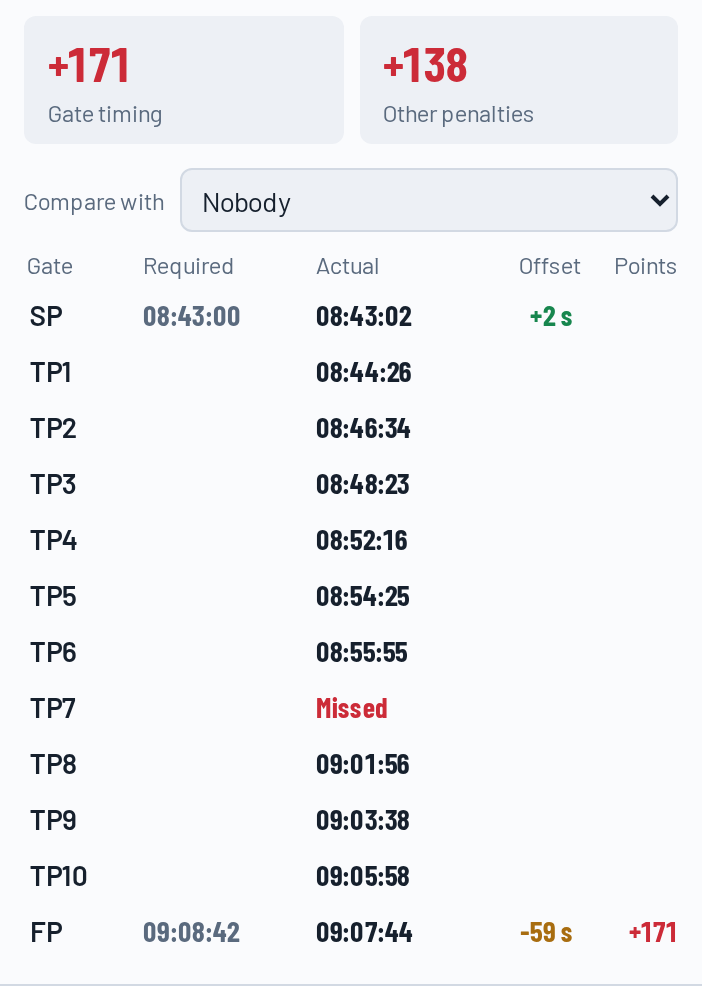
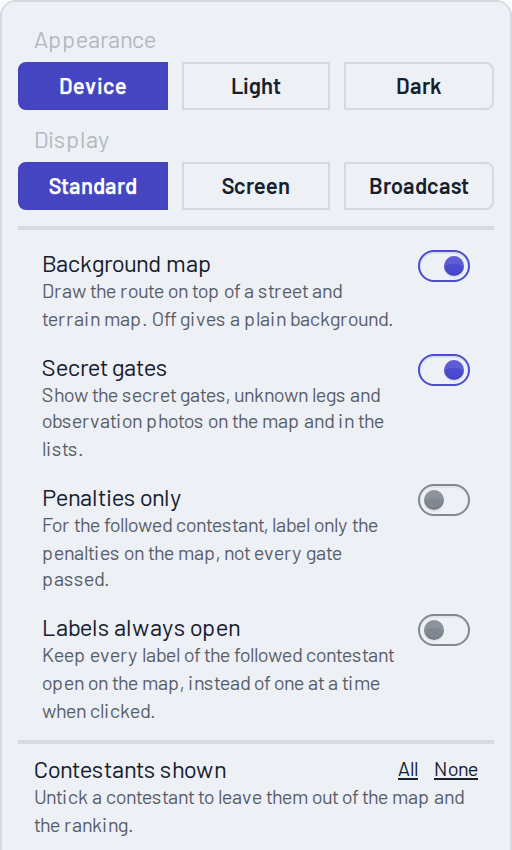

# The Live Map: Watching, Following and Debriefing a Flight

> **New to ASLT?** Read [How ASLT Works](/docs/00_How_ASLT_Works) first. This guide is about one page: the **live map** of a navigation task, which is also what opens when you tap *View your flight* in the mobile app.

The live map is one page that is used in several ways, and it changes to suit each of them:

| I want to... | Use | Go to |
| --- | --- | --- |
| See how the whole competition is going, on a phone or a big screen | The ranking and the map | [Spectators](#spectators-the-whole-field) |
| Follow one contestant through their gates as it happens | Follow a contestant | [Following a contestant live](#following-a-contestant-live) |
| Leave a screen at the airfield running by itself | The airfield screen display | [Airfield screens](#airfield-screens) |
| Put the map on air in a broadcast | The broadcast display | [Broadcast](#broadcast) |
| Go through my own flight after landing | The log, the gates table and the replay | [Pilot debrief](#pilot-debrief) |

The **?** button in the panel's toolbar opens this guide at the part that fits what you are looking at.

---

## Spectators: the whole field

Open the contest's task from the Mission Dashboard, or follow a link someone shared. The map shows the route and every contestant who is flying; the **panel** beside it (on a phone, across the top) lists everyone.

**The ranking.** Each row has the contestant's colour (the same as their track on the map), their name and their score. Under the name you see what they are doing: *Starts in 4:12*, *Adaptive start, by 14:30*, or *Enroute*. A green dot means positions are arriving right now, and a thin bar shows how far along the route a flying contestant is. Contestants who have not started yet are listed below *Not started yet*. The best is first: in tasks where points are penalties, as in precision and navigation flying, the lowest score is the best.

**Live and Replay.** *Live* shows the flights as they happen. *Replay* plays them back from the recorded tracks, with a slider, play and pause, and speeds from real time to 100 times faster.

**On a phone.** The panel starts folded to a strip with the task and the clock, so the map has the room; unfold it with the button at its left. The list is one line per contestant and never takes more than 40% of the height. A small *Flying* tag shows who is in the air, and contestants waiting to start show *Starts 4:12* in place of their score (*Starts 34 d* when it is days away). Tap a contestant to follow them.

**Tools** (the icons in the panel):

*   **Settings** - appearance, display, and what is shown. See [Every button and setting](#every-button-and-setting).
*   **Full trails** - show every contestant's whole track, not only the last minutes.
*   **Task information** - the rules and what is scored in this task.
*   **Contest results** - the results of the whole contest.
*   **Manage** - for organizers.
*   **Book a flight** - where the organizer allows pilots to book their own.
*   **?** - this guide.

**Light and dark.** The map follows your device's light or dark mode, like the rest of the site. To choose for the map alone, open *Settings* and pick *Light* or *Dark* under *Appearance*. *Device* follows the device again.

**Delay.** An organizer can hold the live display back by a number of minutes. The panel then says *Live data is 5 min behind, as the organizer has set.* The clock and the countdowns follow the delay.

---

## Following a contestant live

Tap a name in the ranking (or an aircraft on the map). Everyone else leaves the map, and the **follow bar** appears along the bottom.

**The follow bar** shows who is flying (the pilot and, where there is one, the navigator), their **score**, their **place**, and how far they are from the contestants just above and below: for example *18 behind Zavacký st.* and *27 ahead of Kalakaj*. While they fly it also shows:

*   **The countdown to the next gate.** The big figure counts down to the gate's **required time**, which never moves. Beside it, in green or red, is how many seconds early (minus) or late (plus) the contestant is **predicted** to cross, updated every few seconds from their speed and the distance left. After the required time has passed it counts up in red.
*   **The timing scale.** From *Early* to *Late*, with the grace period, where no points are given, in green. The points for being further off are marked along the line, and the pointer shows where the contestant is predicted to cross, with the points that would give. After the crossing the pointer keeps the result.
*   **The danger meter,** where the task has one: how close the contestant is to a penalty such as leaving the corridor, and the penalty building up.

**The flight list** under the ranking (on a phone, the *Flight* tab) lists the gates in order: a tick for each gate crossed with its offset (*+2 s*), *Missed* with its points where the gate was missed, the penalties under the gate they belong to, and the **next gate** highlighted with the time left. Click a gate to see where it was crossed. In a turnpoint hunt, where the pilot chooses the order, the gates are listed in the order they were crossed. Poker runs and landing tasks have no flight list: the follow bar shows the cards, or the landing.

**Notices at the gate.** Whenever *any* contestant crosses a timed gate, a short notice appears at the gate for a few seconds, such as *SP Zavacky +2 s*, green inside the gate's grace period and red outside it.

**The map follows the aircraft.** It centres on the contestant when you start following, shows the aircraft and its next gate together whenever the next gate changes, and pans when the aircraft nears the edge. Move the map yourself (drag, wheel, double-click, pinch) and it stops, so you can look around; **Follow again** puts the camera back on the aircraft. **Show the whole route** (top right of the map) fits the whole route and also pauses the camera.

**Pilot and navigator.** On a phone the crew takes turns in the bar every few seconds. *Pilot* and *Navigator* keep one of them shown; press it again to let them take turns again.

**Clear** (in the panel) or a tap on the same contestant goes back to everyone.

---

## Airfield screens

For a TV or monitor at the airfield that nobody is operating, choose **Screen** under *Display* in *Settings*, or open the map with `?display=screen` added to the address.

*   The panel stays open, with larger type and clock, so the ranking can be read from a few metres.
*   It goes round by itself: the whole route for a minute, then each contestant who is in the air for 30 seconds, round and round. A contestant who lands drops out of the next round, and one who takes off joins it.
*   A click, touch, wheel or key press **holds** it for two minutes, so a person can look around; after that it starts again from the whole route.
*   It rotates only in *Live*.

The keys listed under [Keys](#keys) also work on a screen. Use the browser's own full screen (**F11**) to remove the browser's bars.

---

## Broadcast

For a broadcast or a stream, choose **Broadcast** under *Display* in *Settings*, or open the map with `?display=broadcast`. To start on one contestant, add `contestantIds` as well (see [Link options](#link-options)).

*   Only the map is left: no site header, no panel, no zoom or scale controls. OpenStreetMap's credit stays, small, as its licence requires.
*   The follow bar becomes a **lower third** floating over the foot of the map: crew, score, place, the countdown and the timing scale.
*   The **follow camera is always on** while someone is followed, so the aircraft stays in the picture.
*   The buttons at the top right of the map, **Show the whole route** and **Leave broadcast**, are only visible while the mouse moves, so they stay out of the picture.
*   Gate notices appear at the gates as in the live view.

Run it in a full browser window (**F11**) and capture that window, or give the address to a browser source in your broadcast software. An operator can steer with the [keys](#keys): follow the leader with **1**, step through the contestants in the air with the arrow keys, and press **Esc** to show the whole field.

To leave broadcast, move the mouse and press **Leave broadcast**, or choose *Standard* under *Display* in *Settings*.

---

## Pilot debrief

Open the map from the app with *View your flight*, or from the link to your flight (for example in the e-mail you get when scoring of your flight starts). The map opens on your flight; once the flight is scored to the end, the panel shows your **navigation log**.

**The gates table** is at the top of the log tab: one row per gate with its required time, the time you actually crossed it, the offset and the points. Above it are the two totals that add up to your score: **Gate timing** and **Other penalties** (leaving the corridor, penalty zones, observations, landing, penalties from the organizer). Click a gate to see it on the map and in the replay.

**The log** under the table lists every result and penalty with the time, the gate and a short description. Click an entry: the map moves to where it happened and opens its label, and the replay moves to that moment so you can play on from there.

**The replay** covers **your own flight**, from takeoff to landing, so the slider is not full of other people's flying. *Whole day* brings back the full time span with all contestants. The red marks on the slider are your penalties; click one to jump to it. The slim row above the replay bar shows you, your score and your place at the replay's time, so you can watch it change as the replay passes each penalty.

**Compare with** (above the gates table) puts another contestant beside you. Choose someone, for example the winner: the table shows both of your offsets and points at each gate side by side, the map shows both tracks, and the replay covers both flights. Choose *Nobody* to stop comparing, or select someone else to end it.

---

## Every button and setting

Hold the mouse over any button to see what it does. Here they all are.

**In the panel**

| Button | What it does |
| --- | --- |
| Fold or unfold (top of the panel) | Hides or shows the panel. Folded, a narrow strip keeps the clock in view. |
| **Live** / **Replay** | Live shows the flights as they happen; Replay plays them back from the recorded tracks. |
| Settings (sliders icon) | Opens the settings menu, below. |
| Full trails (route icon) | Shows every contestant's whole track instead of only the last minutes. |
| Task information (i) | The rules and what is scored in this task. |
| Contest results (cup) | The results of the whole contest. |
| Manage (cog) | Opens the task's management page. Organizers only. |
| Book a flight (calendar) | Opens booking, where the organizer allows pilots to book their own flights. |
| ? | Opens this guide at the part that fits what is on screen. |
| **Ranking** / **Flight** / **Log** | With a contestant selected: the ranking of everyone, the gates of their flight (a tab on phones; wider screens show it under the ranking), and their navigation log with the gates table. |
| **Clear** | Back to all contestants. |

**In the settings menu**

| Setting | What it does |
| --- | --- |
| **Appearance:** Device / Light / Dark | Device follows your device's light or dark mode. Light or Dark always uses that. Kept in this browser. |
| **Display:** Standard / Screen / Broadcast | Standard is the usual page. Screen is the airfield screen. Broadcast is the clean picture for a broadcast. See above. |
| **Background map** | Draws the route on top of a street and terrain map. Off gives a plain background. Not available where the organizer has turned the background map off. |
| **Secret gates** | Shows the secret gates, unknown legs and observation photos on the map and in the lists. Not available where the organizer keeps them hidden. |
| **Penalties only** | For the followed contestant, labels only the penalties on the map, not every gate passed. |
| **Labels always open** | Keeps every label of the followed contestant open on the map, instead of one at a time when clicked. |
| **Contestants shown** (*All* / *None*) | Untick a contestant to leave them out of the map and the ranking. |

**On the map**

| Button | What it does |
| --- | --- |
| **Show the whole route** (top right) | Fits the whole route in the map. Pauses the follow camera until *Follow again*. |
| **Leave broadcast** (top right, in broadcast only) | Back to the standard view. |
| **Follow again** | Appears when you have moved the map by hand; the map follows the aircraft again. |

**In the follow bar and the replay bar**

| Button | What it does |
| --- | --- |
| **Pilot** / **Navigator** | On small screens, which of the crew is shown; press again to let them take turns. |
| Play, pause, back to the start | Control the replay. |
| Slider | Drag to any moment. Red marks are penalties; click one to jump to it. |
| **Whole day** | The replay covers all contestants' whole time span instead of only the selected flight. |
| **Speed** | How fast the replay plays: 1 times is real time, up to 100 times. |
| **Compare with** | In the gates table: put another contestant's gates beside the selected one. |

---

## Link options

Add these to the end of the map's address (`?first=...&second=...`):

| Option | Effect |
| --- | --- |
| `contestantIds=15292` | Opens on that contestant, selected. Several ids, separated by commas, show only those contestants. Your own flight's link in the app already has it. |
| `mode=playback` | Opens in Replay. |
| `time=2026-08-05T06:45:00Z` | Where the replay starts (UTC). |
| `speed=10` | The replay speed, 1 to 100. |
| `autoplay=true` | Starts the replay playing. |
| `display=screen` or `display=broadcast` | The airfield screen, or the broadcast display. Without it, the standard view. |
| `rankingExpanded=true` or `false` | Opens the panel unfolded or folded. |

---

## Keys

In the **screen** and **broadcast** displays (press **?** to see the list on the map):

| Key | What it does |
| --- | --- |
| **1** to **9** | Follow the contestant in that place. |
| **Left** and **right** arrows | Follow the previous or next contestant who is in the air. |
| **F** | Turn the follow camera on or off. |
| **Esc** | Back to the whole field (or closes the key list). |
| **?** | Shows or hides the key list. |

The keys do nothing while you are typing in a field, or with Ctrl, Cmd or Alt held, so the browser's own shortcuts still work.

---

## Good to know

*   **Secret gates stay secret.** They show only where the organizer's task shows secrets *and* the *Secret gates* setting is on. A secret gate's crossing is not announced and its place is not on the flight list otherwise.
*   **Gate times with an adaptive start** are set when the contestant crosses the starting point, so the flight list says so until then, and the countdown starts after the start.
*   **The countdown ticks smoothly** between the updates from the server, and corrects for the difference between your clock and the time of the positions (and for any delay the organizer has set).
*   **A notice or a countdown that is missing** usually means the task does not time that gate: only gates with a time check are timed.
*   **Scrubbing the replay** does not produce gate notices; playing past a gate does.
*   **Replays of old flights** cover the contestant's track; the gate arrow and the danger meter are shown live only.
*   **Tasks with other rules** (poker run, landing) show what fits them: cards in the follow bar, no gate list.

## Questions

**The map does not follow the aircraft.** You have probably moved the map: press **Follow again**. The camera also waits while *Show the whole route* is in use.

**A contestant is not in the ranking.** Contestants who have not started are listed under *Not started yet*. If someone is missing altogether, the contestant filter in *Settings* may have them unticked, or the link you opened has `contestantIds` in it, which shows only those contestants.

**The panel is gone.** You are in the broadcast display. Move the mouse and press **Leave broadcast**, or remove `display=broadcast` from the address.

**I want the same view tomorrow.** Settings are remembered in the browser only for *Appearance*. To keep a view, save the address with its options.
