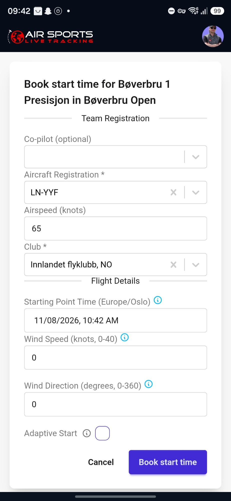
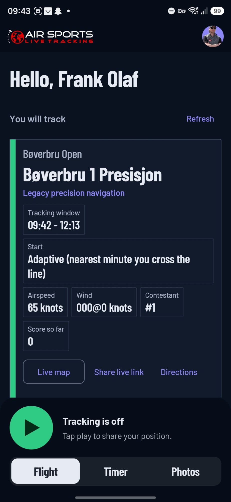
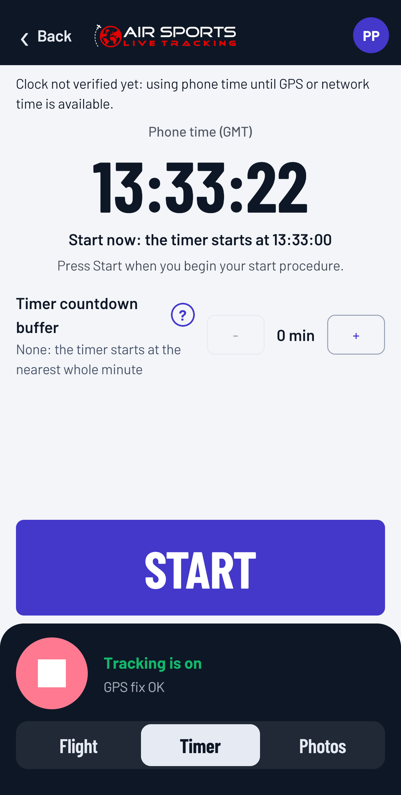
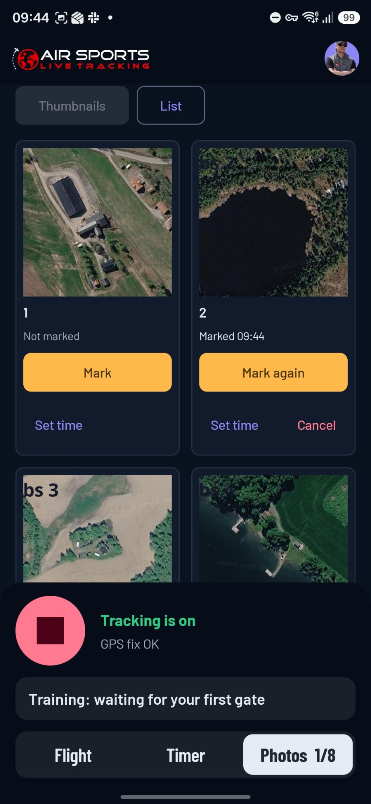

# Register for a Navigation Task at Your Airfield

A short guide for pilots who want to fly the navigation task at their local airfield. It takes about five minutes, and you do it **at home, before you drive to the airfield**: your flight order (with the map and the photos) is sent to you by email, and you need to print it.

**In short**

1. [Sign up or sign in](#sign-up-or-sign-in) in the app.
2. [Register a flight](#register-a-flight): *Register today*, pick the task, *Register a flight*.
3. [Use adaptive start](#use-adaptive-start).
4. [Print your flight order](#print-your-flight-order) from the email.
5. On the day: [the timer](#the-timer) and [marking the photos](#mark-the-photos).

---

## Before you start

*   Install **Air Sports Live Tracking** from Google Play (Android) or the App Store (iPhone).
*   Tracking your flight needs a small annual subscription through the store, which covers the server costs. See [the Contestant Guide](/docs/02_Contestant_Guide#1-install-and-sign-in).

---

## Sign up or sign in

Open the app.

*   **New?** Tap **Create an account**, enter your email and a password, and open the verification link we email you. Then return to the app. Or continue with **Google** (or **Apple** on iPhone).
*   **Been here before?** Tap **Sign in**.

Use the same email address every time. Your flights are matched to you by email.

If you are already signed in, you are on the home screen and can go straight to the next step.

---

## Register a flight

1.  On the home screen, tap **Register today**. It lists the events where registration is open, with the nearest first.
2.  Find the navigation task that is **Open now** and tap **Register a flight**.
3.  The form opens (screenshot below). Check that these are right:
    *   **Aircraft Registration**
    *   **Airspeed** (knots)
    *   **Club** (your flying club)
4.  Set **Starting Point Time**: the time you want to cross the starting point.
5.  Enter the **Wind Speed** (knots) and **Wind Direction** (the direction the wind blows from, in degrees). Use the forecast. The wind is used to calculate your planned times.
6.  Tick **Adaptive Start** (see [below](#use-adaptive-start)).
7.  Tap **Book start time**.

The app confirms that your flight is registered, and it now shows under **My flights**, in **Upcoming**. Within a few minutes you get an email with your flight order.

> **On the website instead of the app?** The form also asks "How will you fly this?" Choose *In a real aircraft*. The app chooses for you.

---

## Use adaptive start

We recommend that you tick **Adaptive Start**.

*   You do not have to hit an exact time. You can cross the starting line any time from **one hour before to one hour after** the Starting Point Time you chose.
*   Your start time becomes the **nearest whole minute** at which you cross the starting line, and all your gate times are counted from that minute. A delay on the ground or in the air does not ruin your flight.
*   The app's **Timer** is there for adaptive-start flights: see [the timer](#the-timer).

Without adaptive start your gate times are fixed from the Starting Point Time you booked, so a late start costs you penalty points.

---

## Print your flight order

The email has a link to your **flight order**. Open it and **print it before you leave home**: you take the paper in the aircraft.

It has your briefing, the gate times, the map, and, depending on the task, photos of the turning points and the photos you will look for in flight.

Some task types ask you to declare your route first. The flight order is then sent as soon as you have saved your declaration.

---

## The timer

The timer helps you cross the starting line on a whole minute. It is in the app, and **only for flights with adaptive start**.

1.  Open the **Timer** tab at the bottom of the screen, next to **Flight**. Also press the **play** button to start tracking before take-off.
2.  Choose a **countdown buffer** if you want a lead-in. With 2 minutes, the timer starts at -2:00 and counts to 0:00. Tap *What is the countdown buffer?* in the app for an explanation.
3.  Press **START** when you begin your start procedure. Before you press it, the page shows the minute the timer would start at.
4.  The timer counts from the same whole minute that the system uses as your start time, so you can cross the starting line at 0:00. After that, it shows the time since your start minute. Pressed too early? Tap **Reset** and press **START** again. Tracking is not affected.
5.  Where the organiser allows training mode, the page also has a **gate countdown** to the next gate's required time. It starts when you cross the starting point.

Tap a timer to show it large. The timer runs on GPS time.

---

## Mark the photos

Some tasks have photos you must find along the route. The photos are in your flight order, **numbered 1, 2, 3 and so on**, and the **Photos** tab in the app shows the same numbers. The tab is there only for tasks that use photo observations.

1.  Start tracking before you mark photos. A mark is stamped with your position and time.
2.  When you see the place of a photo on your track, open the **Photos** tab and tap **Mark** on that photo.
3.  Missed it? Tap **Set time** and enter the time you saw the place.

Marks are saved even if you have no coverage, and are sent when you do. You get no score feedback during the flight, and the marks are final when the flight is over.

---

## More help

*   [Contestant Guide](/docs/02_Contestant_Guide): everything for pilots, including how to get the phone ready.
*   [The Live Map](/docs/15_Live_Map): follow the flights, and go through your own flight afterwards.
*   [FAQ](/faq).
*   Stuck? Write to [support@airsports.no](mailto:support@airsports.no).
